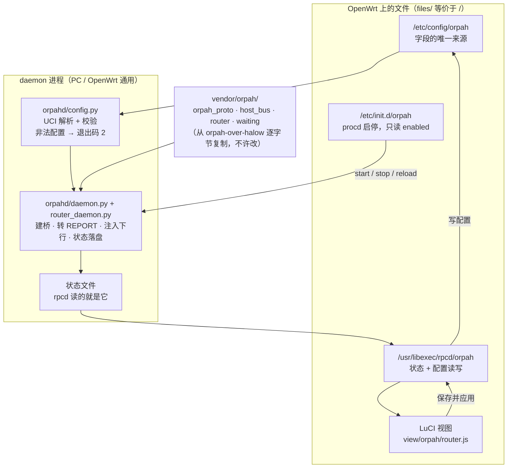
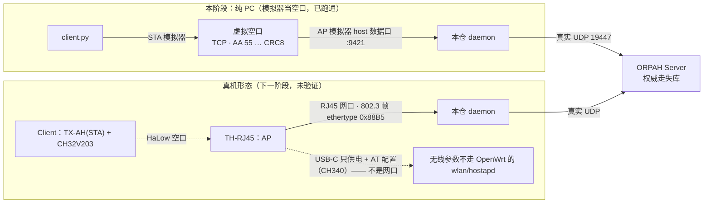

# orpah-openwrt-demo

ORPAH-over-HaLow 的**路由器侧**：把 ORPAH 业务跑在 OpenWrt 路由器上。

三个仓库的分工（本仓是第三个）：

| 仓库 | 负责 | 不碰 |
|---|---|---|
| `halow-demo` | 空口 / 设备 / 长距（模拟器、固件、硬件测试台） | 业务 |
| `orpah-over-halow` | 业务全链路（协议、Server、Client、定位/回放/告警…），**纯 PC + Python** | 空口、路由器 |
| **`orpah-openwrt-demo`（本仓）** | 把「路由器那一段」搬上 OpenWrt：daemon + 包（UCI / procd）+ LuCI 薄前端 | 空口、Server 业务 |

**业务逻辑不在本仓**：`vendor/orpah/` 是从 `orpah-over-halow` **逐字节复制**的
`RouterBridge`（双向桥：空口 ⇄ UDP ⇄ Server）。本仓只在它两侧加壳 —— 配置来源（UCI）与
传输实现（PC 的 TCP host 口）。见 [`vendor/orpah/VENDOR.md`](vendor/orpah/VENDOR.md)。

---

## 现在到哪一步（如实）

**能做的（本阶段范围 = 纯 PC 可跑，不碰真机）**

- ✅ 一个能在 PC 上跑起来的 router daemon：读配置 → 建桥 → 转 REPORT / 注入下行 → 落状态文件
- ✅ 一键自检 `python run_checks.py`（三套件，都不需要 OpenWrt / 真机 / 上游模拟器）
- ✅ OpenWrt 包形态定下来：`Makefile`（两个包）、`/etc/config/orpah`、procd init、rpcd 状态后端、
  LuCI 菜单/ACL/视图

**还没做的（都如实标在 README 与 AGENTS 里）**

- ❌ **真机未验证**：包没在 OpenWrt SDK 上构建过；LuCI 页没在真 LuCI 上渲染过
- ❌ **传输只做了 PC 那条**：真机的空口是 TH-RJ45 经 **RJ45** 送来的 802.3 帧（以太类型 `0x88B5`），
  不是 TCP host 口 —— 需要给 `RouterBridge` 开「可注入传输」的口子（属下一阶段）
- ❌ **无线参数不由 LuCI 管**：SSID / 频点 / 带宽 / PSK 在 TH-RJ45 模组里，用 AT 命令经 CH340 串口配，
  不走 OpenWrt 的 wlan/hostapd 那条路（详见下面「LuCI 管到哪」）
- ❌ **路由器侧观测（xport）未实现**：上游开放问题 —— 定位用的路由器测量不在签名预像里，
  所以 `station_id` 目前**只用于日志与状态页显示，不进任何报文**

---

## 一图看懂（架构）

谁产生配置、谁读配置、谁看状态 —— 一张图说完（节点名就是仓库里的文件名）：



字段只有一处（`/etc/config/orpah`）：init 脚本只读 `enabled`，其余由 daemon 自己解析；
LuCI 直接读写同一份文件。**本仓不碰真机**（阶段 B）：可以画这张框图，但没有“在 OpenWrt 上跑过”
的截图/照片（见 `AGENTS.md` §0）。

## 数据通路

本阶段（PC，用模拟器当空口）与真机形态（下一阶段）的对照 —— 下面两段 ASCII 是同一个东西的
**文件级版本**（哪一段是哪个脚本）：



本阶段（PC，用模拟器当空口）：

```
[Client host] --STA 模拟器--> [虚拟空口] --AP 模拟器--> [本 daemon] --真实 UDP--> [Server]
  client.py                    sim.py (STA)              router_daemon.py          server.py
```

真机形态（下一阶段；`T-Halow-RJ45/docs/ethernet_bridge_linux.md` 实测结论）：

```
[Client] ))) HaLow ))) [TH-RJ45 (AP)] --RJ45--> [OpenWrt 网口] --> daemon --UDP--> [Server]
                                     ^ USB-C 只供电 + AT 配置（CH340），不是网口
```

---

## 快速开始（PC）

依赖：Python 3.8+（本仓只用标准库；`python3-light` 即可）。整链路联调还需要
`orpah-over-halow` 提供空口模拟器与 Server/Client。

### 1. 一键自检（不需要任何外部东西）

```bash
python run_checks.py
```

三套件：配置解析 / 打包文件一致性 + 语法检查 / daemon 端到端（进程内假 AP + 假 Server）。
报告写到 `checks_report.md`。

### 2. 只跑 daemon（需要一个 AP 的 host 数据口）

```bash
# 终端 1：AP 模拟器（来自 orpah-over-halow，提供 host 数据口 9421）
python F:/git/orpah-over-halow/vendor/halow/sim.py \
    --name Router-AP --role AP --console 9401 --link 9411 --host 9421

# 终端 2：本仓的 daemon（配置直接读仓库里那份 OpenWrt 配置）
python router_daemon.py --config files/etc/config/orpah --status-file status.json

# 看状态（rpcd/LuCI 读的就是这个文件）
cat status.json
```

### 3. 整链路联调（5 个终端；Client 上报 → Server 落库）

> 端口都用命令行参数给；如果本机已经有 `orpah-over-halow` 的 UI/模拟器在跑（占 94xx 一套），
> 换一组端口即可（下面用 95xx）。

```bash
# 终端 1：AP 模拟器（Router 侧）
python F:/git/orpah-over-halow/vendor/halow/sim.py \
    --name Router-AP --role AP --console 9501 --link 9511 --host 9521
# 终端 2：STA 模拟器（Client 侧，连上 AP 的空口）
python F:/git/orpah-over-halow/vendor/halow/sim.py \
    --name Client-STA --role STA --console 9502 --link 9512 --peer 127.0.0.1:9511 --host 9522
# 终端 3：Server（真实 UDP 19448）
python F:/git/orpah-over-halow/server.py --port 19448
# 终端 4：本仓 daemon（命令行覆盖端口，配置文件仍然是单一源）
cd F:/git/orpah-openwrt-demo
python router_daemon.py --config files/etc/config/orpah \
    --ap-port 9521 --server-port 19448 --status-file status.json --station-id AP-01
# 终端 5：Client 周期上报（等 STA 关联上 AP 再开）
python F:/git/orpah-over-halow/client.py --sta-port 9522 --sn CN-WH01-9AF3C1D2 --every 3
```

成功的样子：daemon 终端打出 `[router] [1] 上行 ORPAH-REPORT sn=… -> 127.0.0.1:19448`，
`status.json` 里 `up_count` 跟着涨；Server 端能看到上报并回 `TRACKING-STATUS`（daemon 会把它
注入回空口，所以 Client 侧会收到回执）。

---

## OpenWrt 上怎么装

> ⚠ **未在 OpenWrt SDK 上构建验证**（本机没有 SDK；构建与上机由用户执行）。下面是包形态与步骤。

```bash
# 在 OpenWrt 源码树里
cp -r orpah-openwrt-demo package/orpah
make menuconfig     # Network → orpah ；LuCI → Applications → luci-app-orpah
make package/orpah/compile V=s
```

装出来的东西：

| 路径 | 内容 |
|---|---|
| `/usr/lib/orpah/router_daemon.py` | 入口 |
| `/usr/lib/orpah/orpahd/*.py` | 壳（配置 / 进程编排） |
| `/usr/lib/orpah/vendor/orpah/*.py` | 逐字节复制来的上游协议层 + `RouterBridge` |
| `/etc/config/orpah` | **配置（字段的单一源）**，conffile |
| `/etc/init.d/orpah` | procd：只读 `enabled`，其余交给 daemon |
| `/usr/libexec/rpcd/orpah` | 状态后端（把 daemon 落的状态 JSON 透给 LuCI） |
| `/usr/share/luci/menu.d/orpah.json`、`/usr/share/rpcd/acl.d/orpah.json` | 菜单与权限 |
| `/www/luci-static/resources/view/orpah/router.js` | 状态页 + 配置表单 |

## 配置：`/etc/config/orpah`

| 字段 | 默认 | 说明 |
|---|---|---|
| `enabled` | `0` | 是否随开机启动。**只由 init 脚本消费**（daemon 不看它） |
| `station_id` | `AP-01` | 站位标识。**目前只用于日志与状态页显示**（路由器侧观测未实现，不进报文） |
| `ap_host` / `ap_port` | `127.0.0.1` / `9421` | 空口接入点（本阶段 = 模拟器 host 数据口） |
| `server_host` / `server_port` | `127.0.0.1` / `19447` | ORPAH Server（真实 UDP） |
| `self_mac` | `4A:06:59:80:00:01` | 下行注入帧的源地址 |
| `log_level` | `info` | `info` = 逐帧日志；`warn` = 只留错误 |

**为什么字段只有一处**：OpenWrt 惯例是 init 脚本 `config_get` 后逐项传参，那样字段名会同时出现在
UCI 文件 / init 脚本 / LuCI 表单三处，任一处写错就是「改了配置像没改」的静默失效。本仓改成 init
脚本只读 `enabled`，其余由 daemon 自己解析 UCI（`orpahd/config.py`），LuCI 直接读写同一份文件。
`tests/test_package_files.py` 会守住「init / LuCI 引用的字段都存在于 UCI 文件」。

## LuCI 管到哪、不管什么

**管**：守护进程状态（运行中？上行/下行/发现计数、走失缓存条数、是否已同步走失表、运行时长），
以及 `enabled` / `station_id` / 空口地址端口 / 服务器地址端口 / 本机 MAC / 日志级别。

**不管（故意的）**：

- **HaLow 无线参数**（SSID / 频点 / 带宽 / PSK）—— 它们在 TH-RJ45 模组里，用 AT 命令经 CH340 串口
  配置，不是 OpenWrt 的 `wlan`/hostapd 那条路。要做的话是另一件事：在路由器上认到
  `kmod-usb-serial-ch341` 后由页面下发 AT 命令（真机风险高，未做）。
- **Server 侧的任何东西**（走失表、案件、告警）—— 那些在 `orpah-over-halow` 的 Web UI 里。

保存并应用后会由 procd 自动重启 daemon（`procd_add_reload_trigger` + `procd_set_param file`）。

---

## 代码结构

```
orpah-openwrt-demo/
├── router_daemon.py            # 入口（PC / OpenWrt 通用）
├── orpahd/
│   ├── config.py               # 配置：UCI 文本 / key=value / 命令行覆盖 + 校验
│   └── daemon.py               # 薄壳：建桥、状态落盘、信号
├── vendor/orpah/               # 从 orpah-over-halow 逐字节复制（不许改，见 VENDOR.md）
├── files/                      # 装到 OpenWrt 的文件树（等价于 /）
├── Makefile                    # OpenWrt 包（orpah + luci-app-orpah）
├── tests/                      # 自检套件（+ fake_air.py 假空口/假 Server）
└── run_checks.py               # 一键跑全部套件，出 checks_report.md
```

## 自检

```bash
python run_checks.py                 # 全套（约 1 秒）
python tests/test_daemon.py          # 单跑某套件
```

判定 = **退出码 0 且输出无 `FAIL` / `Traceback`**（有些脚本自己吞异常还会往下跑）。
`tests/test_package_files.py` 里含**静态检查**：`sh -n` 校验两个 shell 脚本、`node --check` 校验
LuCI 视图、JSON 可解析、Makefile 的 recipe 必须是 TAB、安装路径与 daemon 的 import 期望一致。
用到的工具（`sh` / `node`）在本机找不到时是**明确跳过**，不是默默通过。

## 未做 / 下一步

1. **真机传输**：给上游 `RouterBridge` 开「可注入传输」口子，实现 AF_PACKET 收 `0x88B5` 帧
   （改上游 → 重新复制 vendor → 更新 VENDOR.md 的 hash 表）。
2. **在 OpenWrt SDK 上构建并上机**（由用户执行）：`opkg install kmod-usb-serial-ch341`（若要用 AT）、
   确认 RJ45 口 `speed=100 / carrier=1`、验证 daemon 起停与 LuCI 页面渲染。
3. **路由器侧观测（xport）**：让 `station_id` 真正进报文（上游开放问题，先与用户对齐再动）。
4. **真机 RTC / 能量标定**等同上游 ROADMAP 的阶段二条目。

## 许可

Apache-2.0（见 `LICENSE`）。`vendor/orpah/` 来自 `orpah-over-halow`（同许可）；
复制关系的来源提交与逐字节 hash 见 [`vendor/orpah/VENDOR.md`](vendor/orpah/VENDOR.md)。
